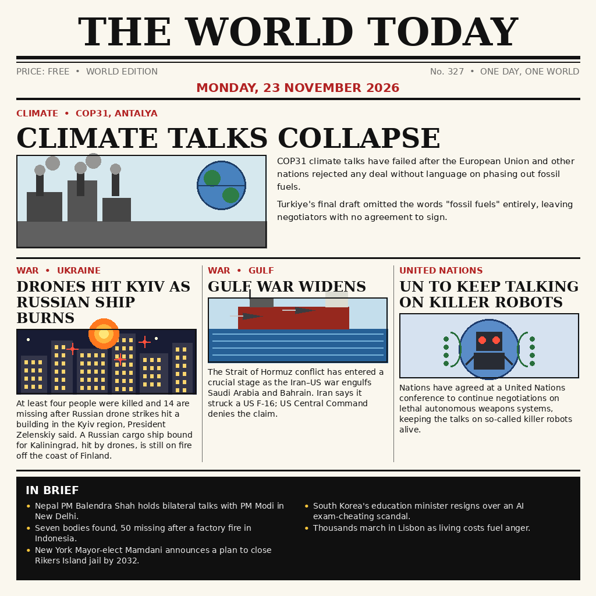

# THE WORLD TODAY — 23 November 2026


Entry for the make.fun competition [news-image-20261123](https://make.fun/c/news-image-20261123): one broadsheet front page summing up the world's news of **Monday, 23 November 2026**.



## The day's news

- **CLIMATE TALKS COLLAPSE** — COP31 fails as the EU and others reject any deal without language on phasing out fossil fuels; Turkiye's final draft omits the words "fossil fuels" entirely.
- **DRONES HIT KYIV AS RUSSIAN SHIP BURNS** — At least 4 killed and 14 missing after Russian drone strikes in the Kyiv region; a Russian cargo ship bound for Kaliningrad is still on fire off Finland.
- **GULF WAR WIDENS** — The Strait of Hormuz conflict enters a crucial stage as the Iran–US war engulfs Saudi Arabia and Bahrain; Iran says it struck a US F-16, US Central Command denies it.
- **UN TO KEEP TALKING ON KILLER ROBOTS** — Nations agree at a UN conference to continue negotiations on lethal autonomous weapons systems.
- **IN BRIEF** — Nepal PM Shah meets PM Modi in New Delhi; South Korea's education minister resigns over an AI exam-cheating scandal; seven bodies found, 50 missing after a factory fire in Indonesia; thousands march in Lisbon over living costs; NYC Mayor-elect Mamdani plans to close Rikers Island jail by 2032.

## How it is built

`render.py` draws the whole newspaper from scratch with Pillow (masthead, four stories with hand-drawn vector panels, black IN BRIEF band). The output is deterministic: two runs produce byte-identical PNGs. `main.ts` copies `entry.png` to `$MAKEFUN_OUTPUT_DIR/entry.png` (default `out`) and verifies the copy by reading it back (PNG signature, 1024×1024 dimensions, byte identity).

```sh
python3 render.py
mkdir -p out && MAKEFUN_OUTPUT_DIR=out node main.ts
```

## Files

- `entry.png` — the newspaper, 1024×1024, under 1 MiB
- `render.py` — the renderer (Python + Pillow)
- `main.ts` — the entry point (Node 22, standard library only)
- `LICENSE` — MIT
